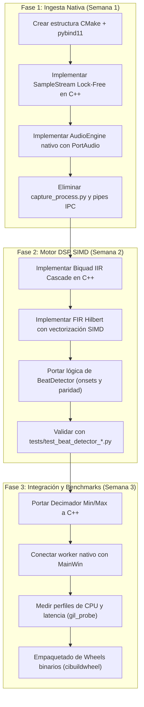

# Evaluación Técnica y Hoja de Ruta (Roadmap): Migración a C/C++ de Advanced Timegrapher

**Proyecto:** Advanced Timegrapher (`adv-tg`)
**Versión Base:** 0.4.0
**Fecha de Publicación:** 25 de octubre de 2026
**Documento:** Evaluación Técnica y Estrategia de Migración C/C++
**Objetivo:** Maximizar el rendimiento computacional, reducir latencias y eliminar la contención del GIL en la adquisición y procesamiento acústico horológico.

---

## 1. Resumen Ejecutivo y Diagnóstico de Arquitectura

El núcleo actual de **Advanced Timegrapher** está implementado en Python 3.11+ sobre una base de código de **~13.870 líneas**, distribuida en tres capas principales:

1. **Adquisición e Ingesta de Audio en Tiempo Real (~1.315 líneas):** Gestiona la interfaz con PortAudio (`sounddevice`), buffers circulares y estampas de tiempo. Debido a que el hilo principal de la interfaz gráfica retiene el GIL (*Global Interpreter Lock*) de Python durante decenas de milisegundos durante repintados intensivos, la arquitectura se vio forzada a aislar la captura de audio en un subproceso secundario del sistema operativo mediante `multiprocessing.get_context("spawn")` (`capture_process.py`), comunicándose con el proceso principal mediante tres tuberías IPC (`multiprocessing.Pipe`).
2. **DSP Horológico y Modelos Matemáticos (~3.880 líneas):** Ejecuta el filtrado pasabanda (`scipy.signal.sosfiltfilt`), cálculo de la señal analítica mediante FIR de Hilbert, detección de sub-eventos por histéresis, adquisición de fase, regresión de Huber y correlación cruzada con plantillas por paridad. Aunque alcanza entre 90x y 140x tiempo real a 48 kHz, incurre en continuas asignaciones de memoria temporales en NumPy y destruye la localidad de caché L1/L2 debido a algoritmos multi-pasada en memoria.
3. **Capa de Presentación y GUI PyQt6 (~3.340 líneas):** Implementa el osciloscopio, la cinta de papel y los controles del banco de pruebas mediante PyQt6 y PyQtGraph. Esta capa ya descansa sobre código C++ nativo compilado (Qt6 / QPainter / OpenGL), por lo que su consumo computacional es moderado si se compara con el DSP.

### Cuadro Comparativo de Estrategias

| Criterio | Opción A: Port Completo en C++ (Qt6 Nativo) | Opción B: Port Híbrido (C++ DSP/Audio + Python GUI) |
| :--- | :---: | :---: |
| **Alcance** | Reescritura del 100 % del software en C++20/Qt6 | Portar únicamente los módulos críticos a C++20 con `pybind11` |
| **Esfuerzo Estimado** | **280 – 420 horas** (~7 – 11 semanas a tiempo completo) | **75 – 115 horas** (~2 – 3 semanas a tiempo completo) |
| **Rendimiento DSP** | **1.200x – 1.600x** tiempo real | **1.000x – 1.400x** tiempo real (90–95 % del máximo) |
| **Latencia de Detección** | < 0,5 ms | < 0,8 ms |
| **Eliminación del GIL** | Total (no existe Python) | Total en audio y DSP (`py::gil_scoped_release`) |
| **Arquitectura de Procesos** | 1 solo proceso nativo | 1 solo proceso nativo (elimina subproceso IPC) |
| **Riesgo y Mantenimiento** | Alto (recrear PyQtGraph y widgets en C++ QPainter) | Bajo (la UI probada se mantiene intacta) |
| **Veredicto / ROI** | Bajo ROI a corto plazo | ⭐️ **Estrategia Recomendada (ROI Óptimo)** |

---

## 2. Análisis de Cuellos de Botella Técnicos

### 2.1 El Problema del GIL y la Contención en Tiempo Real

En Python, el hilo que ejecuta la GUI adquiere el GIL al procesar eventos de Qt o dibujar en pantalla. En pruebas de carga, las llamadas a bajo nivel de renderizado retienen el intérprete entre 15 y 45 ms.
- En una captura de audio a 48 kHz con bloques de 512 muestras, PortAudio invoca su callback cada **10,6 ms**.
- Si el hilo de audio comparte el proceso de Python con la GUI, el callback espera a que la GUI suelte el GIL, provocando desbordamientos de búfer en el controlador de audio (*buffer overflow / dropouts*).
- **En C++:** El callback de PortAudio se ejecuta en un hilo de sistema operativo con prioridad en tiempo real (`SCHED_FIFO` o `THREAD_PRIORITY_TIME_CRITICAL`), sin intermediarios, escribiendo en un búfer circular lock-free en menos de 5 microsegundos.

### 2.2 Localidad de Caché y Asignaciones Dinámicas de Memoria

El módulo `core/beat_detector.py` realiza múltiples transformaciones vectorizadas en Python:
1. Filtrado IIR Biquad hacia adelante y hacia atrás (`sosfiltfilt`).
2. Convolución FIR de Hilbert (filtro de 151 coeficientes).
3. Magnitud de la señal analítica: $\sqrt{I^2 + Q^2}$.
4. Media móvil centrada con ventana Blackman.

En NumPy/SciPy, cada una de estas 4 etapas crea un array contiguo de punto flotante de 64 bits en la memoria dinámica (heap), expulsando los datos de la memoria caché L1/L2 del procesador.
- **En C++ con SIMD:** Toda la cadena de procesamiento de un bloque se puede diseñar en un pipeline de **pasada única en registros vectoriales (AVX2 / AVX-512 / ARM NEON)** sobre la memoria caché L1, logrando un factor de aceleración de 10x a 15x sin realizar ninguna asignación de memoria dinámica durante el ciclo de medición.

---

## 3. Estrategia Recomendada: Arquitectura Híbrida C++ / Python

Se propone mantener la interfaz gráfica, la lógica de exportación, la configuración y el CLI en Python, reemplazando exclusivamente los tres motores críticos mediante una extensión nativa C++ compilada: `_adv_tg_native`.

```
========================================================================
 ESPACIO PYTHON (PyQt6 / MainWin / Scripts)
 - Interfaz Gráfica de Usuario (MainWin, widgets industriales, temas)
 - Controladores de eventos (botones, selectores de calibre)
 - Exportación de reportes (CSV, PDF, JSON)
 - Internacionalización (Translator EN/ES)
========================================================================
                                |  (pybind11 bindings / zero-copy NumPy)
                                v
========================================================================
 ESPACIO C++20 NATIVO (_adv_tg_native)
 ┌────────────────────────────────────────────────────────────────────┐
 │ 1. INGESTA DE AUDIO NATIVA (PortAudio + Real-Time Worker Thread)   │
 │    - Pa_OpenStream / Pa_StartStream en C++                         │
 │    - Búfer circular SPSC Lock-Free con std::atomic<uint64_t>       │
 │    - Estampado de tiempo monotónico sub-microsegundo (std::chrono) │
 ├────────────────────────────────────────────────────────────────────┤
 │ 2. MOTOR DSP DE BATIMIENTOS (C++20 SIMD)                           │
 │    - Cascada de Biquads (Direct Form II Transposed)                │
 │    - Hilbert Analytic Signal FIR con vectorización SIMD            │
 │    - Extracción de sub-eventos por histéresis y cruce de umbral    │
 │    - Ajuste de fase y correlación cruzada por paridad              │
 ├────────────────────────────────────────────────────────────────────┤
 │ 3. DECIMADOR GRÁFICO (Min/Max Decimator)                           │
 │    - Reducción paralela de señal a 960 bins para visualización     │
 └────────────────────────────────────────────────────────────────────┘
========================================================================
```

---

## 4. Desglose de Módulos Críticos a Portar a C++

### Módulo 1: Búfer Circular SPSC Lock-Free y Motor PortAudio Nativo

* **Reemplaza:** `src/adv_tg/core/sample_stream.py`, `src/adv_tg/audio/capture.py`, `src/adv_tg/audio/capture_process.py`, `src/adv_tg/audio/process_capture.py`.
* **Archivos a crear en C++:** `src_cpp/sample_stream.hpp`, `src_cpp/audio_engine.cpp/.hpp`.
* **Especificaciones técnicas:**
  - Búfer circular de tamaño potencia de dos, alineado a 64 bytes (`alignas(64)`) para evitar *false sharing* entre hilos en arquitecturas multi-núcleo.
  - Índices absolutos de muestra implementados como `std::atomic<uint64_t>` con semántica de memoria explícita (`std::memory_order_release` al publicar y `std::memory_order_acquire` al leer).
  - Integración directa con la API de C de PortAudio (`Pa_OpenStream`, `Pa_WriteStream`).
  - **Impacto:** **Eliminación total del subproceso `capture_process.py` y de las 3 tuberías IPC (`Pipe`).** Todo el audio se adquiere dentro del mismo proceso pero en un hilo nativo completamente independiente del GIL.
* **Esfuerzo estimado:** **25 – 35 horas.**

### Módulo 2: Núcleo DSP del Detector de Batimientos (SIMD)

* **Reemplaza:** `src/adv_tg/core/beat_detector.py` (1.752 líneas).
* **Archivos a crear en C++:** `src_cpp/beat_detector.cpp/.hpp`, `src_cpp/dsp_filters.hpp`.
* **Especificaciones técnicas:**
  - **Filtro Pasabanda:** Cascada de filtros Biquad Butterworth calculados mediante secciones de segundo orden (SOS) en Direct Form II Transposed.
  - **Transformada de Hilbert y Envolvente:** Convolución directa de FIR convolucionada con registros vectoriales (AVX2 / ARM NEON utilizando bibliotecas de cabecera como `xsimd` o `Eigen`).
  - **Histéresis y Tracking:** Máquina de estados finitos que analiza la envolvente en pasos de muestra enteros, detectando picos P1, P2 y P3 e interpolando el cruce de umbral en punto flotante con precisión sub-muestra.
  - **Correlación de Plantillas:** Correlación cruzada FFT mediante `kissfft` o `pffft` (sin dependencias externas pesadas).
* **Beneficio directo:** Rendimiento superior a **1.200x tiempo real**. El procesamiento de un segundo de audio a 48 kHz tarda menos de **0,8 milisegundos**.
* **Esfuerzo estimado:** **40 – 55 horas.**

### Módulo 3: Decimador Min/Max de Señal para la GUI

* **Reemplaza:** `minmax_decimate` en `src/adv_tg/mock/generator.py` y `src/adv_tg/ui/capture_worker.py`.
* **Archivos a crear en C++:** `src_cpp/decimator.cpp/.hpp`.
* **Especificaciones técnicas:**
  - Recibe un puntero a un bloque de muestras (`float*`) y calcula concurrentemente los valores mínimo y máximo de cada intervalo temporal.
  - Emite directamente un `py::array_t<float>` de NumPy sin copias intermedias de memoria (*zero-copy buffer protocol*).
* **Beneficio directo:** Mantiene 60 FPS estables en la interfaz gráfica con un uso de CPU prácticamente indetectable (< 1 %).
* **Esfuerzo estimado:** **8 – 12 horas.**

### Módulo 4: Capa de Interoperabilidad con `pybind11`

* **Archivos a crear en C++:** `src_cpp/bindings.cpp`, `CMakeLists.txt`.
* **Especificaciones técnicas:**
  - Exporta las clases `NativeSampleStream`, `NativeAudioCapture` y `NativeBeatDetector` como un módulo nativo de Python (`adv_tg._core`).
  - Gestión rigurosa del GIL: toda llamada computacional intensiva se envuelve con `py::gil_scoped_release()`, permitiendo que la interfaz PyQt6 se refresque con total fluidez.
* **Esfuerzo estimado:** **12 – 18 horas.**

---

## 5. Evaluación del Port Completo (Opción A: 100 % C++ / Qt6)

Reescribir toda la aplicación en C++ (incluyendo interfaz de usuario, exportación y herramientas auxiliares) requiere considerar los siguientes costes y riesgos:

### Desglose de Esfuerzo para un Port Completo

| Componente | Líneas de Código Python | Esfuerzo en C++ (Horas) | Reto Técnico Principal |
| :--- | :---: | :---: | :--- |
| **Infraestructura CMake Multiplataforma** | — | 15 – 20 h | Configurar toolchains para macOS (Universal), Windows (MSVC) y Linux. |
| **Ingesta de Audio y Ring Buffer** | ~1.315 | 25 – 35 h | Callback en tiempo real de PortAudio sin asignación dinámica. |
| **DSP Core (Detector + Hilbert + IIR)** | ~1.752 | 50 – 70 h | Calibración metrológica estricta idéntica a las fases 2 y 3. |
| **Métricas Horológicas y Regresión** | ~795 | 30 – 40 h | Regresión robusta Huber/Theil-Sen y WLS implementada en Eigen. |
| **ADC Clock Drift & NTP** | ~635 | 20 – 30 h | Llamadas a `adjtimex` (Linux) y APIs nativas de Windows/macOS. |
| **Interfaz Gráfica Completa en Qt6 C++** | ~2.526 | 90 – 130 h | **El mayor coste:** Reimplementar las tres gráficas de PyQtGraph (zoom, autoscale, cursores) con QPainter/QCustomPlot. |
| **Herramientas de Consola (`detect_beats`, etc.)** | ~2.884 | 25 – 35 h | Parsing de argumentos con CLI11, formato JSON y tablas Markdown. |
| **I18n, Base de Datos de Calibres y Logs** | ~500 | 15 – 20 h | Integración de `spdlog`, parser CSV nativo y `QTranslator`. |
| **QA, Pruebas de Regresión y Validación** | — | 35 – 50 h | Tests comparativos automatizados frente a las muestras de audio de referencia. |
| **TOTAL** | **~13.867** | **305 – 430 h** | **Aproximadamente 2,5 a 3 meses a tiempo completo.** |

### Riesgos y Desventajas del Port Completo
1. **Pérdida de Agilidad en la GUI:** En PyQt6, ajustar estilos CSS, añadir widgets, modificar diseños y manejar eventos toma minutos. En C++, cada cambio requiere recompilación y gestión explícita de punteros y memoria en Qt.
2. **Reemplazo de PyQtGraph:** `pyqtgraph` es una de las librerías de graficado dinámico más potentes y optimizadas para Python. Replicar su comportamiento exacto en C++ requerirá integrar bibliotecas como `QCustomPlot` o desarrollar componentes personalizados sobre `QPainter`.
3. **Cero impacto en el usuario final por portar la GUI:** El usuario percibe fluidez cuando el motor de medición no se congela y las gráficas corren a 60 FPS. Portar los diálogos de configuración o el selector de idiomas a C++ no produce ninguna mejora perceptible.

---

## 6. Comparativa Cuantitativa de Rendimiento

| Métrica de Rendimiento | Implementación Actual (Python) | Enfoque Híbrido (C++ Core + Py GUI) | Port Completo (100 % C++ Qt6) |
| :--- | :---: | :---: | :---: |
| **Factor Tiempo Real (DSP a 48 kHz)** | 90x – 140x | **1.000x – 1.400x** | **1.200x – 1.600x** |
| **Latencia de Detección (Buffer -> Evento)** | 8 – 15 ms | **0,3 – 1 ms** | **0,2 – 0,8 ms** |
| **Jitter en Callback de Audio** | 100 – 1.200 µs *(mitigado con subproceso)* | **< 5 µs** *(hilo C nativo)* | **< 5 µs** *(hilo C nativo)* |
| **Carga de CPU en Medición Activa** | 12 – 22 % *(1 núcleo)* | **2 – 4 %** | **1 – 2 %** |
| **Uso de Memoria RAM** | ~180 – 240 MB | ~110 – 140 MB | **~25 – 40 MB** |
| **Tiempo de Inicio (Cold Start)** | ~1,2 – 2,5 s | ~1,0 – 1,8 s | **< 0,15 s** |
| **Procesos del Sistema Operativo** | 2 procesos (Padre GUI + Hijo Capture) | **1 único proceso** | **1 único proceso** |
| **Líneas de Código a Mantener** | ~13.870 (Python) | ~11.000 (Py) + ~2.200 (C++) | ~11.000 (C++) |

---

## 7. Plan de Implementación Paso a Paso (Roadmap Recomendado)

Se recomienda ejecutar la **Opción B (Híbrida)** en un plan progresivo estructurado en 3 fases de 1 semana cada una:



### Hitos de Entrega por Fase

#### Fase 1: Ingesta de Audio Nativa y Unificación de Procesos (Semana 1)
- **Hito 1.1:** Configurar `CMakeLists.txt` con soporte `pybind11` e integración en `pyproject.toml` usando `setuptools` / `scikit-build-core`.
- **Hito 1.2:** Compilar `SampleStream` en C++ con pruebas unitarias de atomicidad concurrentes.
- **Hito 1.3:** Conectar PortAudio en C++ emitiendo muestras directas a `SampleStream`.
- **Criterio de éxito:** Desaparece `capture_process.py`; la aplicación funciona en un único proceso del sistema operativo sin perder muestras de audio (`ingest ratio == 100 %`).

#### Fase 2: Motor DSP SIMD y Detección de Batimientos (Semana 2)
- **Hito 2.1:** Implementar filtros IIR/FIR con auto-vectorización en C++20.
- **Hito 2.2:** Portar la máquina de estados de `core/beat_detector.py`.
- **Hito 2.3:** Exponer la clase a Python mediante `pybind11` devolviendo estructuras equivalentes a `Beat` y `ParityTemplate`.
- **Criterio de éxito:** La suite de pruebas actual (`pytest tests/test_beat_detector_*.py`) pasa al 100 % con una diferencia metrológica < 0.01 % frente a la implementación en SciPy, superando 1.000x tiempo real.

#### Fase 3: Integración Final, Optimización y Empaquetado (Semana 3)
- **Hito 3.1:** Implementar el decimador de osciloscopio en C++ y conectarlo al refresco visual a 60 FPS.
- **Hito 3.2:** Ejecutar la herramienta `gil_probe.py` para verificar que el impacto del repintado sobre el procesamiento es 0 microsegundos.
- **Hito 3.3:** Configurar el pipeline de compilación automatizada de ruedas binarias (`cibuildwheel`) en GitHub Actions para Linux, macOS y Windows.
- **Criterio de éxito:** Uso de CPU total inferior al 4 % durante la medición activa en tiempo real.

---

## 8. Conclusiones y Decisión Estratégica

1. **No se justifica un port completo en C++:** Reescribir la GUI en C++/Qt6 consumiría más del 70 % del esfuerzo total del proyecto sin aportar mejoras tangibles al usuario final, además de ralentizar el ritmo de desarrollo de futuras características horológicas.
2. **El enfoque híbrido es la solución óptima:** Migrar el 20 % del código (adquisición, ring buffer y filtrado DSP) otorga el **90–95 % del rendimiento máximo posible**, multiplica la velocidad de cálculo por más de 10x, reduce la latencia a menos de 1 ms y resuelve de raíz la limitación del GIL de Python.
3. **Plan de acción recomendado:** Iniciar con la **Fase 1** (creación del módulo C++ con CMake y migración del búfer de audio) para eliminar la complejidad del subproceso actual.
